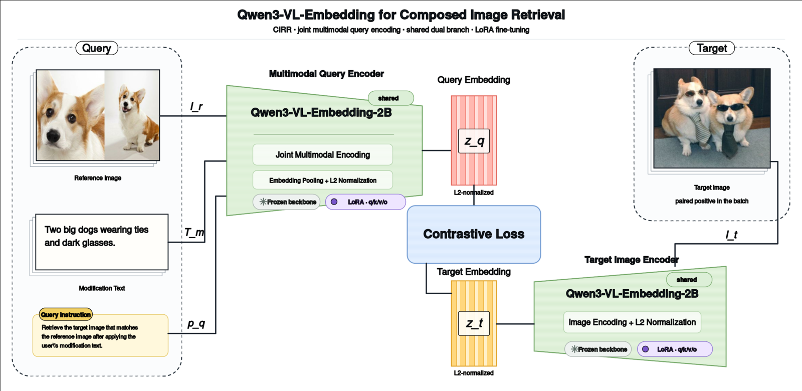

# CLIP4CIR-Qwen

使用 [Qwen3-VL-Embedding-2B](https://huggingface.co/Qwen/Qwen3-VL-Embedding-2B) 在 CIRR 上进行组合图像检索：将参考图像和修改文本编码为查询，在候选图像中检索目标图像。项目包含 zero-shot 检索、LoRA 微调、验证集评估和测试集提交。



## 安装

使用 Python 3.11，默认在 CUDA 上以 BF16 运行。

```bash
git clone git@github.com:amnika2/CLIP4CIR-Qwen.git
cd CLIP4CIR-Qwen
python3.11 -m venv .venv
source .venv/bin/activate
pip install -r requirements.txt
```

模型由 Sentence Transformers 从 Hugging Face 加载，`--model` 也接受本地模型目录。

## 数据集

将 CIRR 图像与标注放在同一根目录，默认读取 `data/cirr/`：

```text
data/cirr/
├── cirr/
│   ├── captions/
│   │   ├── cap.rc2.train.json
│   │   ├── cap.rc2.val.json
│   │   └── cap.rc2.test1.json
│   └── image_splits/
│       ├── split.rc2.train.json
│       ├── split.rc2.val.json
│       └── split.rc2.test1.json
├── train/
├── dev/
└── test1/
```

图像路径按 `split.rc2.*.json` 中的相对路径解析。三个运行入口均支持 `--cirr-root` 指定数据集根目录。

## Zero-shot 评估

```bash
python src/validate.py --batch-size 4
```

查询输入为参考图像、修改文本和检索指令；候选输入为单张图像。编码结果经过 L2 归一化，通过内积计算相似度，并从检索结果中排除参考图像。

验证输出为 JSON，指标单位为百分比：

| 检索范围 | 指标 |
| --- | --- |
| 全部候选图像 | Recall@1、5、10、50 |
| 查询对应的图像组 | Group Recall@1、2、3 |

## LoRA 微调

```bash
python src/train_lora.py \
  --batch-size 16 \
  --gradient-accumulation-steps 4 \
  --epochs 3
```

LoRA 作用于语言模型注意力层的 `q_proj`、`k_proj`、`v_proj`、`o_proj`，训练参数为 adapter 权重。训练使用单向 query-to-target 对比损失，以 batch 内配对的目标图像为正样本，其余目标图像为负样本。

默认每个 batch 包含 16 对样本，累积 4 个 batch 后更新参数，每次更新对应 64 对样本；对比损失的负样本范围为单个 batch。最后一组梯度按实际累积的 batch 数取平均。

| 参数 | 默认值 |
| --- | --- |
| 模型 | `Qwen/Qwen3-VL-Embedding-2B` |
| 精度 | `bfloat16` |
| 训练 / 验证 batch size | `16` / `16` |
| 梯度累积 | `4` |
| Epoch | `3` |
| 学习率 | `5e-5` |
| 权重衰减 | `0.01` |
| 学习率调度 | 5% warmup + cosine decay |
| Logit scale | `100` |
| LoRA rank / alpha / dropout | `16` / `32` / `0.05` |
| 梯度检查点 | 开启 |
| 随机种子 | `42` |

每个 epoch 在完整验证集上重新编码候选图像，以 `(Recall@5 + Group Recall@1) / 2` 选择最佳模型。训练输出包括 adapter 权重、adapter 配置及记录参数和指标的 `training_metadata.json`：

```text
models/qwen3_vl_embedding_2b_cirr_lora/
├── best/
└── last/
```

评估微调后的模型：

```bash
python src/validate.py \
  --adapter models/qwen3_vl_embedding_2b_cirr_lora/best
```

## 测试集提交

生成 LoRA 模型的测试集结果：

```bash
python src/cirr_test_submission.py \
  --name qwen3_vl_embedding_2b_lora_best \
  --adapter models/qwen3_vl_embedding_2b_cirr_lora/best
```

生成 zero-shot 结果：

```bash
python src/cirr_test_submission.py --name qwen3_vl_embedding_2b
```

结果默认写入 `submission/CIRR/`：

| 文件 | 内容 |
| --- | --- |
| `recall_submission_<name>.json` | 每个查询的前 50 张候选图像 |
| `recall_subset_submission_<name>.json` | 每个查询所属图像组的前 3 张候选图像 |

## 运行参数与缓存

所有入口共用 `--model`、`--cirr-root`、`--device`、`--dtype` 和 `--query-instruction`。使用 `--device cuda:1` 指定 GPU；使用 `--device cpu --dtype float32` 在 CPU 上运行。

验证和测试入口还支持 `--adapter`、`--index-cache` 和 `--batch-size`。候选图像特征默认缓存为 `cache/cirr_val.pt` 和 `cache/cirr_test1.pt`；模型、adapter 文件版本、精度、数据集目录或候选列表变化时重新提取。可通过 `--index-cache` 为不同实验指定各自的缓存文件。

训练使用 `--output-dir` 指定 adapter 输出目录，测试提交使用 `--output-dir` 指定 JSON 输出目录。各入口通过 `--help` 查看完整参数。

## 项目结构

```text
src/
├── cli.py                    公共命令行参数
├── data_utils.py             CIRR 标注与图像路径
├── qwen_encoder.py           Qwen 编码与 adapter 推理
├── lora_encoder.py           LoRA 训练前向与 adapter 保存
├── contrastive.py            batch 内对比损失
├── retrieval.py              特征缓存、排序与验证指标
├── train_lora.py             LoRA 训练入口
├── validate.py               验证集评估入口
└── cirr_test_submission.py   测试集提交入口
tests/                       检索与训练回归测试
docs/                        流程图及图像素材
```

`data/`、`cache/`、`models/`、`submission/` 为本地数据和运行产物，由 `.gitignore` 排除。

## 测试

```bash
PYTHONPATH=src python -m unittest discover -s tests -v
```

测试覆盖 CIRR 数据读取、全局与组内排名、参考图像排除、指标计算、提交预测、缓存复用和末组梯度累积。
